<p align="center">
    
</p>

<h1 align="center">Authup</h1>

<p align="center">
    <b>Self-hostable identity and access management for your applications and APIs.</b><br>
    Login pages, OAuth 2.0 and OpenID Connect, second factors, external logins and permissions,<br>
    in one process that any language can talk to.
</p>

<p align="center">
    <a href="https://github.com/authup/authup/actions/workflows/main.yml"></a>
    <a href="https://www.npmjs.com/package/authup"></a>
    <a href="https://snyk.io/test/github/authup/authup"></a>
    <a href="./LICENSING.md"></a>
</p>

<p align="center">
    <a href="#why-authup"><b>Why Authup</b></a>
    ·
    <a href="#quick-start">Quick start</a>
    ·
    <a href="#use-it-from-any-language">Integrate</a>
    ·
    <a href="#sdks">SDKs</a>
    ·
    <a href="https://authup.org">Documentation</a>
</p>

---

## Why Authup?

Every application with users ends up building the same layer: login and password reset pages, sessions and tokens, a second factor, "Sign in with GitHub", an admin screen, and permission checks spread through every API. Authup is that layer, run as a service and spoken to over open standards.

| Concern | With Authup |
|---|---|
| **Sign-in** | Hosted login, consent, registration, password recovery and device verification pages, with TOTP, recovery codes, email codes and passkeys as a second factor |
| **Protocols** | OAuth 2.0 and OpenID Connect: authorization code with PKCE, client credentials, rotating refresh tokens, device authorization, discovery, userinfo, logout |
| **External logins** | Any OAuth2 or OpenID Connect provider (presets for GitHub, Google and others) and LDAP, linkable to existing accounts |
| **Authorization** | Permissions granted to roles, users and clients, each scoped to a realm and optionally guarded by policies (attributes, identity, time, ...) |
| **Tenants** | Realms, each with its own users, clients, roles and signing keys |
| **Operations** | Admin and account consoles, a security event log, Prometheus metrics, and one image that scales out into separate replicas |

<p align="center">
    
</p>

## Quick start

```shell
npx authup@latest start
```

This starts everything on `http://localhost:3000`: the API, the admin console at `/console/admin`, the account console at `/console/account` and the hosted login pages. Sign in to the admin console as `admin` / `start123` in the `master` realm, and change the password. Without a configured database Authup uses SQLite in the current directory, which is for trying it out only.

For a real deployment, run the [Docker image](https://authup.org/guide/deployment/docker) `authup/authup` against PostgreSQL or MySQL, or let the wizard write the files for you:

```shell
npm create authup@latest
```

It asks a few questions and writes a `docker run` env file, a compose project, Helm values or a bare-metal project. The [deployment guide](https://authup.org/guide/deployment/) covers configuration, reverse proxies and scaling out.

## Use it from any language

Authup speaks OAuth 2.0 and OpenID Connect, so the library you already use for "Sign in with ..." works with it, whatever your stack. Point it at the discovery document:

```text
http://localhost:3000/realms/master/.well-known/openid-configuration
```

<p align="center">
    
</p>

### Protect your API

Verify the access token like any JWT, against the keys at the `jwks_uri` of the discovery document, or ask Authup about it with token introspection, which also returns the subject's permissions:

```shell
curl -d "token=$ACCESS_TOKEN" \
  -d "client_id=$CLIENT_ID" -d "client_secret=$CLIENT_SECRET" \
  http://localhost:3000/token/introspect
```

To introspect tokens issued to other clients, the calling client needs the `token_introspect` permission. Node, Socket.IO and Web `Request` servers can use a [server adapter](https://github.com/authup/authup/tree/master/packages/server-adapter-node) instead, which does both and caches the keys.

### Call the management API

Everything the admin console does goes through a REST API. Get a token with client credentials and call it:

```shell
curl -d "grant_type=client_credentials" \
  -d "client_id=$CLIENT_ID" -d "client_secret=$CLIENT_SECRET" \
  http://localhost:3000/token

curl -g -H "Authorization: Bearer $ACCESS_TOKEN" \
  "http://localhost:3000/users?page[limit]=20"
```

The OpenAPI document is served at `/docs/openapi.json`. From a terminal, `npx authup login` and `npx authup api user list` do the same without curl.

## SDKs

Optional packages for JavaScript and TypeScript, for when you want typed calls instead of raw HTTP:

| Package | For |
|---|---|
| [`@authup/core-http-kit`](https://github.com/authup/authup/tree/master/packages/core-http-kit) | A typed client for every endpoint, with token refresh |
| [`@authup/server-adapter-node`](https://github.com/authup/authup/tree/master/packages/server-adapter-node), [`-socket-io`](https://github.com/authup/authup/tree/master/packages/server-adapter-socket-io), [`-web`](https://github.com/authup/authup/tree/master/packages/server-adapter-web) | Token verification middleware for your APIs |
| [`@authup/access`](https://github.com/authup/authup/tree/master/packages/access) | Permission and policy evaluation in your own service |
| [`@authup/client-web-kit`](https://github.com/authup/authup/tree/master/packages/client-web-kit), [`@authup/client-web-nuxt`](https://github.com/authup/authup/tree/master/packages/client-web-nuxt) | Vue components and a Nuxt module for sign-in and administration |

The other workspaces under [`apps/`](apps) and [`packages/`](packages) make up Authup itself; each has its own README.

## Development

```shell
npm install
npm run build
npm run dev
```

`npm run dev` serves server-core and every console on `http://localhost:3000` with hot module replacement. `npm run test` and `npm run lint` run the test suite and the linter (after a build).

## Contributing

Before starting to work on a pull request, it is important to review the guidelines for
[contributing](./CONTRIBUTING.md) and the [code of conduct](./CODE_OF_CONDUCT.md).
These guidelines will help to ensure that contributions are made effectively and are accepted.

## Citation

If you use Authup in academic work, please cite it: GitHub's **"Cite this repository"** button reads [`CITATION.cff`](./CITATION.cff), and [Zenodo](https://doi.org/10.5281/zenodo.20836542) mints a DOI for each release.

```bibtex
@software{placzek_authup,
  author    = {Placzek, Peter},
  title     = {Authup},
  url       = {https://github.com/authup/authup},
  doi       = {10.5281/zenodo.20836542},
  publisher = {Zenodo}
}
```

## License

Made with 💚

Authup is dual-licensed:

- All **applications** under [apps/](apps) (the CLI, core and console services,
  and client bundles) are published under the [AGPL-3.0](./LICENSE). A
  commercial license is available for organizations that cannot meet the AGPL's
  conditions.
- All **packages** under [packages/](packages) (client libraries, SDKs, server adapters, shared kits)
  remain under the permissive [Apache 2.0 License](packages/kit/LICENSE): integrating your own
  application with an Authup server never subjects it to the AGPL.

See [LICENSING.md](./LICENSING.md) for details, or contact **contact@tada5hi.net** for commercial licensing.
